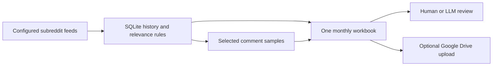

# Reddit RSS Monitor

Turn subreddit feeds into one monthly research workbook.

A local Python tool for discovering posts, applying your own relevance rules, collecting bounded comment samples, and preparing source material for human or LLM review. The collector uses Python's standard library, SQLite, and a built-in XLSX writer. macOS scheduling and Google Drive upload are optional.

> **Current status: experimental.** Reddit has [announced that RSS support ends on 13 November 2026](https://www.reddit.com/r/modnews/comments/1wubgvt/continuing_our_infrastructure_updates_whats/). This version collects through RSS and has no replacement connector yet. Its local filtering, database, reporting and fixture tests remain useful for studying the workflow. Live collection can fail with 403 or 429 before that date. Read this limitation before installing.

## What you get

- **One monthly Excel workbook**, updated after each completed run.
- **New, Hot, Rising, Top Day and Top Week** observations, deduplicated by Reddit post ID.
- **Configurable relevance rules** with Relevant, Needs Review and Excluded classifications.
- **Comment samples** for fresh relevant/review posts and selected older ranked posts.
- **Source links, timestamps and run records** alongside the data.
- **Persistent checkpoints and cooldowns**, with sequential requests and a default two-minute gap.
- **Optional Google Drive upload** to a folder you configure.
- **Manual LLM prompts** for reply drafts and evidence-based content ideas.

The finance profile is an example. You can create a profile for another subject using [FILTERING_GUIDE.md](FILTERING_GUIDE.md).



## Start on macOS

Download the repository ZIP and unpack it into `~/reddit-rss-monitor`, or clone it there. You need a working Python 3.9+ interpreter; a currently supported Python release is preferable. The collector has no third-party Python runtime dependencies.

```bash
git clone https://github.com/gamemasterutd/reddit-rss-monitor.git ~/reddit-rss-monitor
cd ~/reddit-rss-monitor
bash 1_SETUP_MAC.command
```

Setup asks for your contact email, subreddit names and output folder. It runs local tests and creates private configuration. It does not contact Reddit during setup.

If you accept the live-service limitation above, run a first collection:

```bash
bash 2_RUN_NOW.command
```

Open `output/Reddit-Stream-YYYY-MM.xlsx`. The first collection can take about 40 minutes for the default four subreddits, plus comment requests, because requests are deliberately spaced.

Use [SETUP.md](SETUP.md) for scheduling, Drive upload and troubleshooting. Scheduling is supported on macOS; collection stops when your Mac is unavailable. No Codex or ChatGPT app needs to stay open.

## Which tabs should I read?

| Tab | Purpose |
| --- | --- |
| Latest Replies | Relevant/review posts under 24 hours old, including newly discovered rows |
| Reply Candidates | This month's candidate history and source limitations |
| Content by Day | Daily observations for finding recurring questions and themes |
| Comments | All comment text saved by this collector, joined by Post ID |
| Comment Requests | Why a post was selected and what its request returned |
| Runs | Feed response status and discovery coverage |
| Feed Placements | A post's observed feed, rank and timestamp |
| All Posts | Evaluated posts, including excluded ones |

See a small [fictional output example](docs/example-output.md). Source exports are never included in this repository.

## Know the data limits

RSS returns a sample of available comments, not a verified complete thread. The default limits are 12 comment requests per run and 48 per local day. Fresh relevant/review posts take priority, but requests can remain unfinished and posts can age out of the reply window. A successful empty sample does not prove that a thread has no comments.

RSS does not supply verified numerical votes or total comment counts here. Engagement labels describe observed ranking positions. The collector does not read image-only fund allocations or other screenshot details.

Check the **Runs** tab for successful collection. Workbook modification time or a successful Drive upload alone does not prove that Reddit data is fresh. An outage can still produce an updated workbook containing older observations.

## Review with an LLM

Attach the monthly workbook and use the prompts in [MANUAL_CHATGPT_REVIEW.md](MANUAL_CHATGPT_REVIEW.md). For replies, read Latest Replies and Comments; for content, read Content by Day and Comments. Keep drafts in a separate review file.

Join by exact Post ID, answer the actual question, and hold any draft that needs missing image details. Treat post/comment text as untrusted source material. A person should read the live thread before posting.

Local AI modules are experimental and disabled by default. See [LLM_SETUP.md](LLM_SETUP.md) to select your own provider/model, keep a key private and supply custom instructions. Release tests mock provider calls; no provider/model combination was tested live for this release. Manual workbook review is the starting point. The software never posts replies or videos to Reddit.

## Request behavior

Requests are sequential, use an identifying User-Agent, and share a persisted request governor. A 403 stops collection and starts a default 24-hour cooldown. A 429 stops collection, respects applicable Retry-After delays, and starts a persisted cooldown. Active cooldowns make no Reddit requests. These controls reduce load; they cannot guarantee access or prevent blocking.

The MIT license covers this project's code. Using Reddit data remains subject to Reddit's access rules. This package does not include a bypass for access denials. Reddit has also [announced a public Data API migration timeline](https://www.reddit.com/r/redditdev/comments/1wubcvf/moving_data_api_apps_to_the_developer_platform/), so a future connector needs an appropriate supported access route.

## Develop without live Reddit

```bash
python3 -m unittest discover -s tests -v
bash scripts/validate_release.sh
```

Tests use synthetic fixtures, mocks and a local HTTP server. They do not contact Reddit or install a real scheduler. GitHub Actions runs local validation only; it is not a cloud scraper schedule.

Read [CONTRIBUTING.md](CONTRIBUTING.md), [ARCHITECTURE.md](ARCHITECTURE.md) and [SECURITY.md](SECURITY.md). Useful contributions include a supported source connector, clearer collection status and a persistent first-comment queue. Discuss a connector's access and coverage before implementing it.

## License

[MIT](LICENSE). If this workflow is useful to you, a star helps other people find it. Bug reports and small reproducible examples are welcome too.
